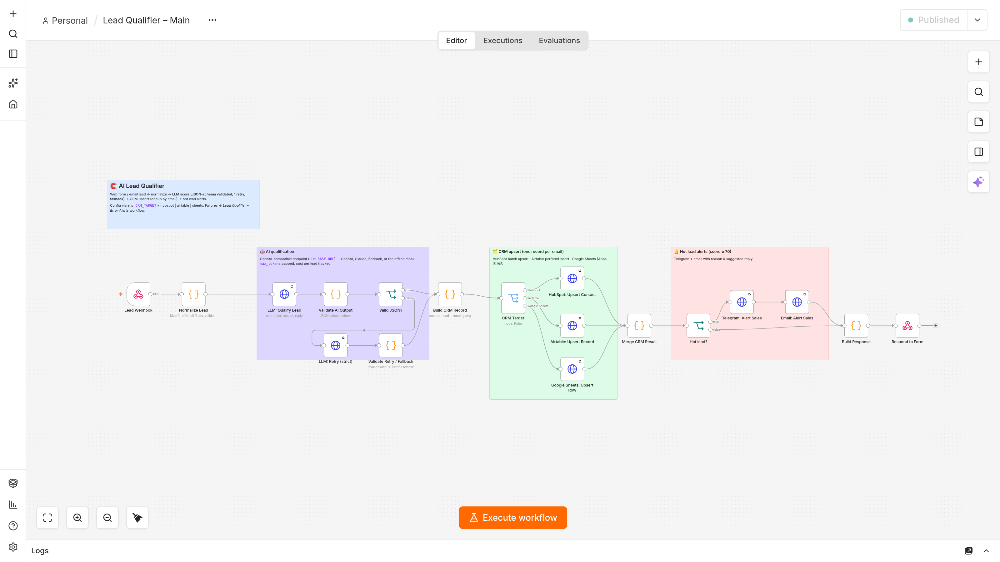
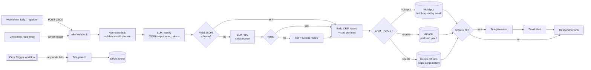
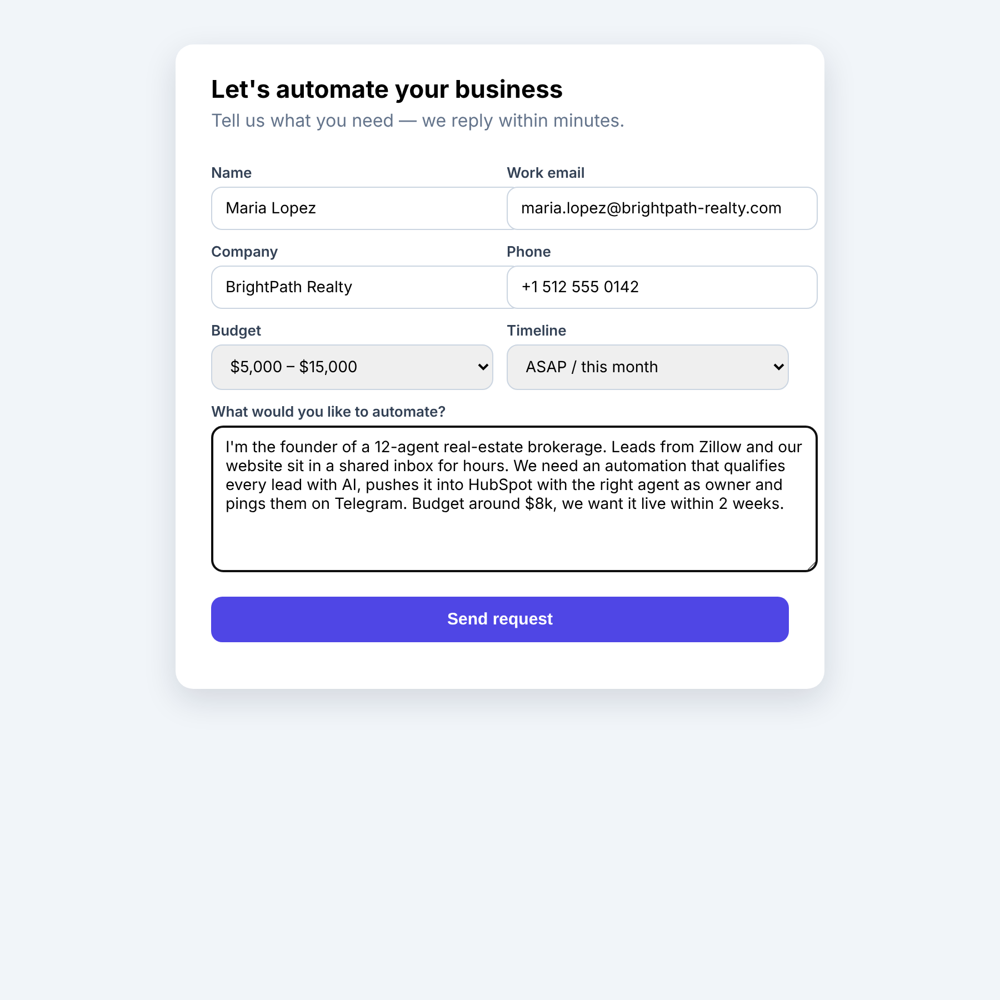
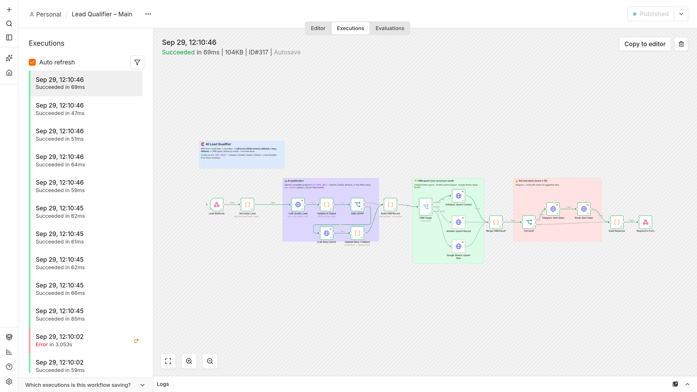
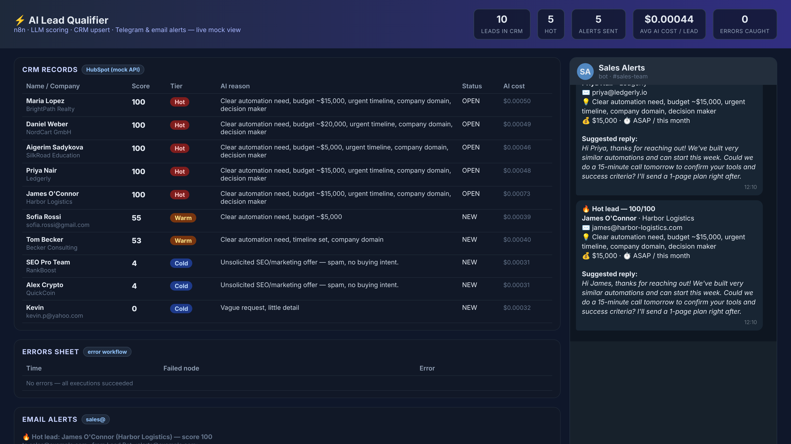
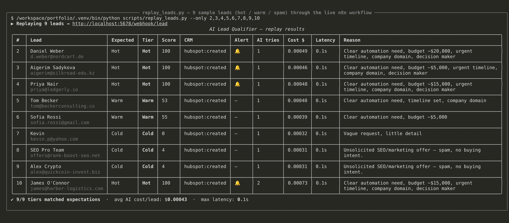
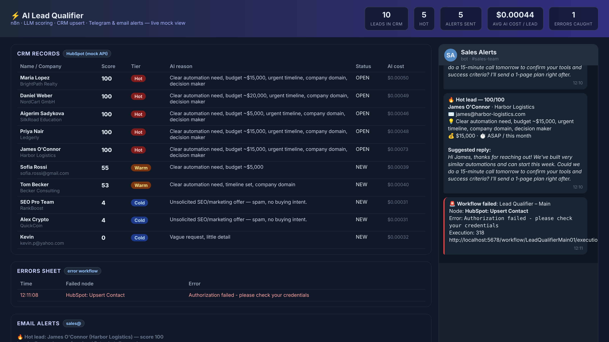
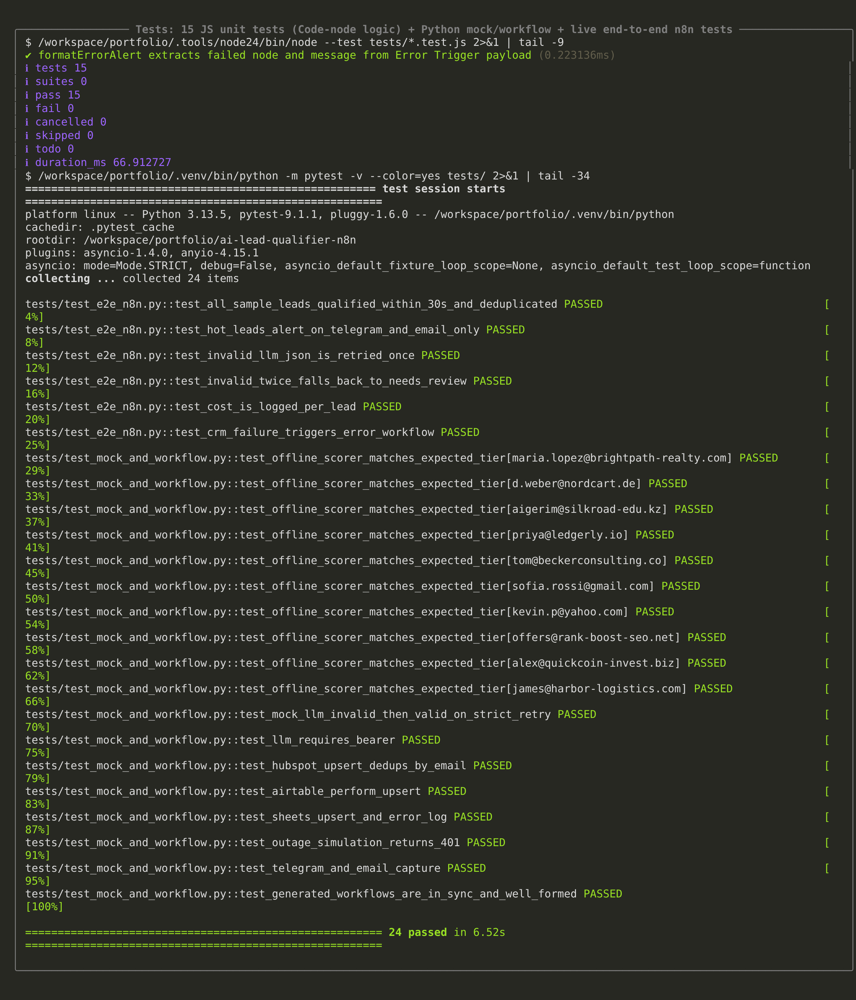
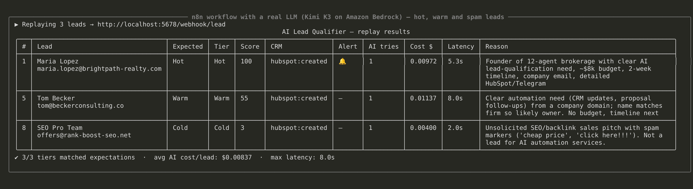
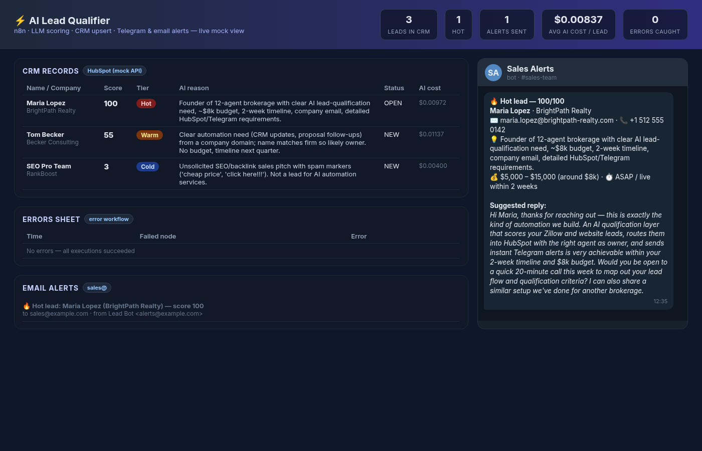

# 🧲 AI Lead Qualifier — n8n + LLM → CRM + instant alerts

> Every inbound lead is captured, de-duplicated, scored by an LLM (0–100 with a written reason), written to your CRM
> (HubSpot, Airtable or Google Sheets) and — if it's hot — pushed to the sales team on Telegram and email with a
> ready-to-send first reply. In well under 30 seconds, with retries, schema validation and an error-alert workflow.



## The problem
Leads arrive from web forms and email. Reps reply hours later, spam wastes their time and hot leads go cold.
This workflow makes the first qualification step instant and consistent, so reps only spend time on qualified prospects.

## What it does
| Step | How |
|---|---|
| Capture | n8n **Webhook** (any form tool: Tally, Typeform, Webflow, HTML form; or a Gmail trigger posting to it) |
| Normalize | Code node maps fields, validates email, derives company domain, stable `lead_id` |
| Qualify | LLM via any **OpenAI-compatible** endpoint (OpenAI, Claude, Bedrock, OpenRouter…) → JSON: `score`, `tier`, `reason`, `intent`, `budget`, `timeline`, `suggested_reply` |
| Validate | JSON-schema check → **1 strict retry** → fallback tier **"Needs review"** (never silently dropped) |
| CRM upsert | Config switch `CRM_TARGET`: **HubSpot** batch upsert by email · **Airtable** `performUpsert` on Email · **Google Sheets** via Apps Script (dedup by Email) |
| Alert | Score ≥ 70 → **Telegram** + **email** with name, company, score, 1-line reason and suggested reply |
| Errors | Separate **Error workflow**: any failed node → Telegram alert + row in the *Errors* sheet |
| Cost guard | `max_tokens` cap; per-lead AI cost and running average written to the CRM record |

## Architecture


## Screenshots
| | |
|---|---|
|  Lead form (hot lead) |  Live n8n execution |
|  CRM records + Telegram alerts |  Replaying 10 sample leads |
|  Revoked CRM key → error alert |  Test suites |
|  Same workflow with a real LLM (Kimi K3 on Amazon Bedrock) |  Real-LLM scores, reasons and suggested reply |

Screenshots 01–08 use the offline mock LLM (deterministic heuristic scorer); 09–10 are the unchanged workflow pointed at
a real model — ~$0.008 per lead at Kimi K3 prices, 2–8 s end-to-end. The LLM nodes retry 5× (5 s apart) so provider
rate-limits (HTTP 429) don't lose leads; if retries are exhausted the error workflow alerts instead of failing silently.

## Quick start (offline demo, ~5 minutes, no accounts needed)
Everything external (LLM, HubSpot, Airtable, Sheets, Telegram, email) is replaced by a local mock that implements
the **real API request/response shapes**, plus a live dashboard.

```bash
git clone <this repo> && cd ai-lead-qualifier-n8n
python -m venv .venv && . .venv/bin/activate && pip install -r requirements.txt
cp .env.example .env                      # offline defaults
./scripts/start_mock.sh &                 # mock APIs + dashboard on http://127.0.0.1:8787
./scripts/start_n8n.sh                    # imports + publishes both workflows, starts n8n on :5678 (Node 24+)
```
Then open the form at http://127.0.0.1:8787/form (or replay the samples) and watch http://127.0.0.1:8787 :
```bash
python scripts/replay_leads.py            # 10 sample leads (hot / warm / spam) from test_leads.json
./scripts/replay_leads.sh                 # same with curl + jq
```
n8n editor: http://localhost:5678 (create the owner account on first visit).

### Docker instead of Node
```bash
docker run -it --rm -p 5678:5678 --env-file .env -e N8N_BLOCK_ENV_ACCESS_IN_NODE=false \
  -v $PWD/workflows:/workflows docker.n8n.io/n8nio/n8n:2.40.7
# then in another shell: docker exec <id> n8n import:workflow --separate --input=/workflows && n8n publish:workflow --id=LeadQualifierMain01
```
(When n8n runs in Docker, point the mock URLs in `.env` to `http://host.docker.internal:8787/...`.)

## Going live with real services
Edit `.env` (or export variables in the shell — they override `.env`) — the workflow reads everything from environment variables, no credentials are stored in the workflow JSON.

| Variable | Real value |
|---|---|
| `LLM_BASE_URL`, `LLM_API_KEY`, `LLM_MODEL` | e.g. `https://api.openai.com/v1` + `gpt-4o-mini`, or any OpenAI-compatible endpoint (Claude, Bedrock, OpenRouter) |
| `LLM_PRICE_INPUT_PER_M`, `LLM_PRICE_OUTPUT_PER_M` | your model's USD price per 1M tokens (for the cost column) |
| `CRM_TARGET` | `hubspot`, `airtable` or `sheets` |
| `HUBSPOT_BASE_URL`, `HUBSPOT_TOKEN` | `https://api.hubapi.com` + private-app token (scope `crm.objects.contacts.write`). Create contact properties: `ai_score` (number), `ai_tier`, `ai_reason`, `ai_intent`, `ai_budget`, `ai_timeline`, `ai_suggested_reply`, `ai_cost_usd`, `ai_avg_cost_per_lead_usd`, `lead_source_detail`, `lead_message` |
| `AIRTABLE_*` | `https://api.airtable.com`, PAT with `data.records:write`, base id, table `Leads` with an **Email** field (other fields are created by `typecast`) |
| `SHEETS_WEBHOOK_URL/TOKEN` | deploy [`apps-script/Code.gs`](apps-script/Code.gs) as a Web App (instructions in the file) |
| `TELEGRAM_API_BASE`, `TELEGRAM_BOT_TOKEN`, `TELEGRAM_CHAT_ID` | `https://api.telegram.org`, token from @BotFather, your sales group id |
| `EMAIL_API_URL`, `EMAIL_API_KEY`, `EMAIL_FROM`, `SALES_EMAIL` | any Resend-compatible email API (`https://api.resend.com/emails`) — or swap the node for n8n's *Send Email* (SMTP) node |

## Acceptance criteria → evidence
| # | Criterion | Where |
|---|---|---|
| 1 | One CRM record per email, < 30 s | HubSpot/Airtable/Sheets upsert by email; `test_all_sample_leads_qualified_within_30s_and_deduplicated` (end-to-end ≈ 0.1–0.2 s with the mock LLM; real LLMs add 2–10 s) |
| 2 | JSON-schema validation, 1 retry, "Needs review" fallback | `validateQualification` + *LLM: Retry (strict)* node; `test_invalid_llm_json_is_retried_once`, `test_invalid_twice_falls_back_to_needs_review` |
| 3 | Hot leads → Telegram + email with name, company, score, reason, reply | `telegramAlert` / `emailAlert`; `test_hot_leads_alert_on_telegram_and_email_only` |
| 4 | 3 CRM targets via config switch | all three implemented; `scripts/e2e_all_targets.sh` runs the e2e suite for each |
| 5 | Error workflow, no silent failures | *Lead Qualifier – Error Alerts*; `test_crm_failure_triggers_error_workflow` |
| 6 | Cost guard, cost per lead logged | `LLM_MAX_TOKENS`, `ai_cost_usd` + `avg_ai_cost_per_lead_usd` columns |
| 7 | 10 sample leads + replay script | `test_leads.json`, `scripts/replay_leads.py`, `scripts/replay_leads.sh` |
| 8 | README, env vars, exported workflow JSON | this file, `.env.example`, `workflows/*.json` |

## Tests
```bash
node --test tests/*.test.js          # 15 unit tests for the Code-node logic (the exact code that runs inside n8n)
pytest                               # mock API contract tests + workflow JSON checks (+ live e2e when n8n is running)
./scripts/e2e_all_targets.sh         # e2e suite once per CRM target (restarts n8n with CRM_TARGET=hubspot|airtable|sheets)
python scripts/demo_screenshots.py   # scripted demo run → docs/screenshots/*.png
```
Results on the reference run: **15/15 JS**, **18/18 Python** unit/contract tests, **6/6 e2e × 3 CRM targets**.

## Project layout
```
src/lead_logic.js              business logic (normalize, prompt, schema validation, CRM adapters, alerts) — unit-tested
scripts/build_workflows.py     generates workflows/*.json and inlines src/lead_logic.js into the Code nodes
workflows/                     importable n8n workflows (main + error handler)
mock/                          mock LLM / HubSpot / Airtable / Sheets / Telegram / email + dashboard + form
apps-script/Code.gs            Google Sheets upsert endpoint
test_leads.json                10 sample leads (hot / warm / spam / invalid-JSON case)
tests/                         JS unit tests, Python contract tests, live e2e tests
```
Edit logic in `src/lead_logic.js`, then run `python scripts/build_workflows.py` (a test fails if you forget).

## Portfolio write-up & demo video script
See [PORTFOLIO.md](PORTFOLIO.md).

## License
MIT — sample data is fictional.
